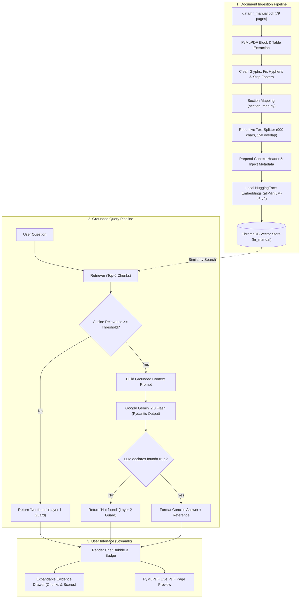
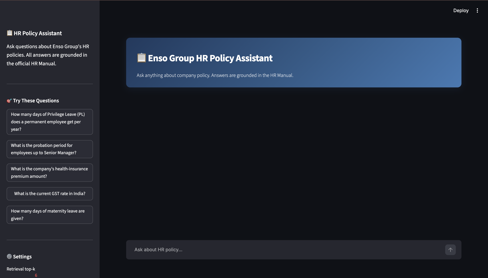
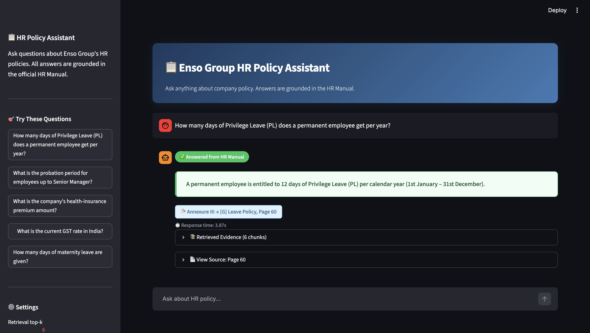
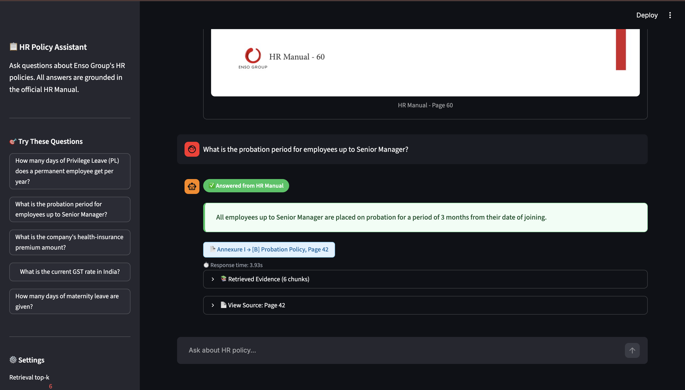
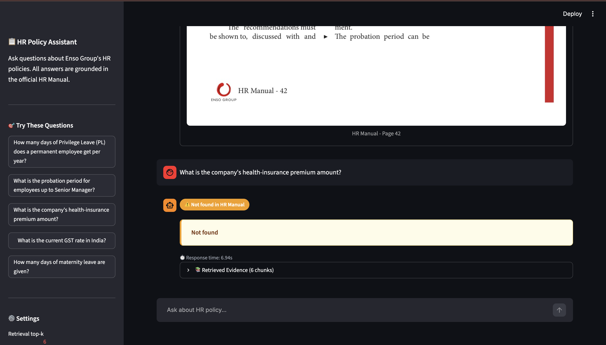
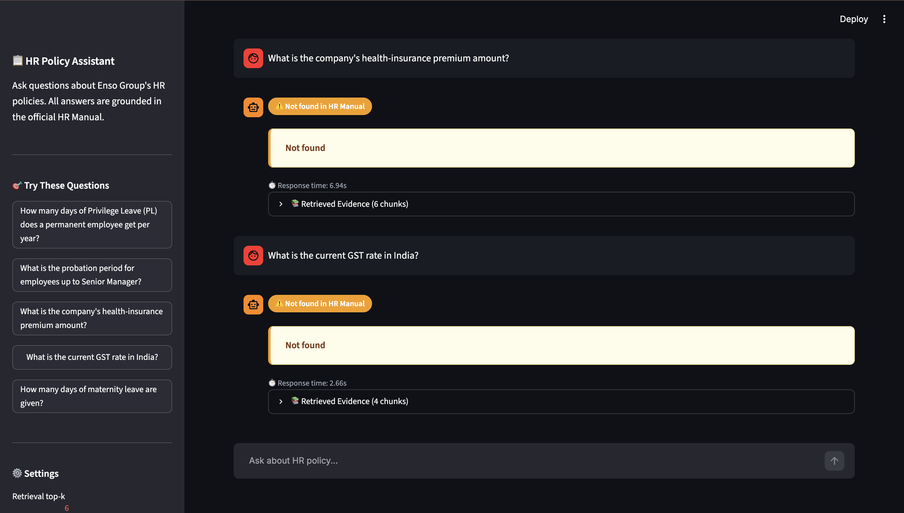
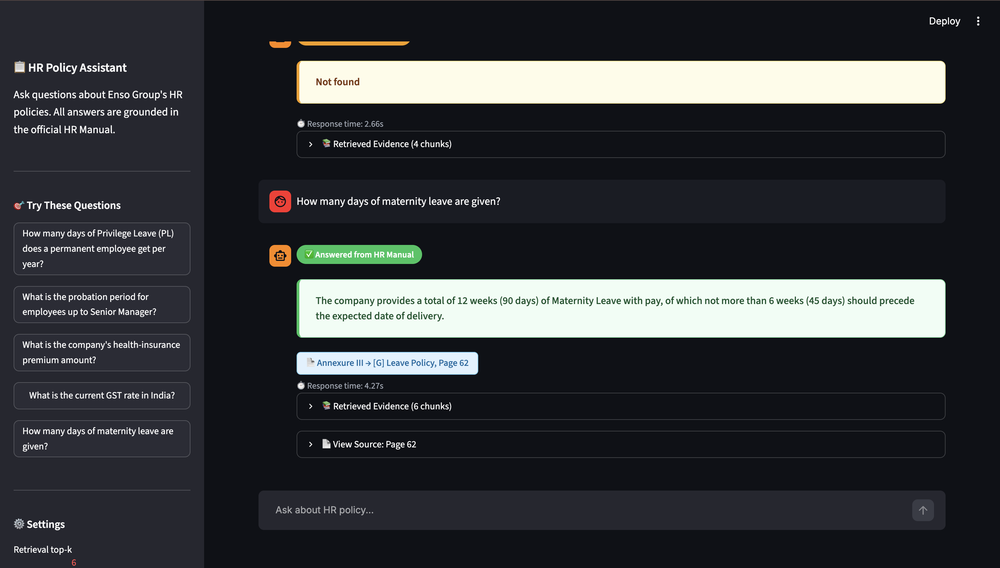

# Enso Group HR Policy Assistant

[](https://www.python.org/)
[](https://www.langchain.com/)
[](https://www.trychroma.com/)
[](https://streamlit.io/)
[](https://ai.google.dev/)

> An enterprise-grade, strictly grounded Retrieval-Augmented Generation (RAG) system answering human resources queries exclusively from the 79-page **Enso Group HR Policy Manual**. Developed as a submission for the Generative AI Mid-Semester Examination.

---

## Table of Contents
1. [Problem Statement & Objective](#problem-statement--objective)
2. [Key Features](#key-features)
3. [Architecture & Data Flow](#architecture--data-flow)
4. [Tech Stack](#tech-stack)
5. [Project Structure](#project-structure)
6. [Quickstart & Setup](#quickstart--setup)
7. [How It Works (Deep Dive)](#how-it-works-deep-dive)
8. [Exam Q&A Evaluation Results](#exam-qa-evaluation-results)
9. [UI Preview & Verification](#ui-preview--verification)
10. [Design Decisions & Trade-offs](#design-decisions--trade-offs)
11. [Author & Academic Details](#author--academic-details)

---

## Problem Statement & Objective

In corporate human resource management, employees often struggle to find authoritative answers to policy questions regarding leave entitlements, probation rules, maternity benefits, and conduct codes within lengthy employee handbooks. Hallucinations or reliance on external unverified information in an HR context can lead to legal liability and employee dissatisfaction.

### Exam Requirements & Ground Rules
- **Stack:** Python + ChromaDB + LangChain (Strictly enforced).
- **Sole Source of Truth:** `hr_manual.pdf` (Enso Group HR Policy Manual, 79 pages).
- **Exact Citations:** Every valid answer must cite policy name, annexure/section, and physical page number matching the PDF footers (`HR Manual - N`).
- **Strict Hallucination Guard:** If a query cannot be answered directly and explicitly from the manual, the system MUST reply exactly: `Not found`. No guessing, no extrapolations, and no references.

---

## Key Features

- **Strict Grounding with Two-Layer Defense**:
  - *Layer 1 (Retrieval Filter)*: Chunks failing minimum cosine relevance threshold are immediately rejected.
  - *Layer 2 (LLM Verification)*: Structured JSON output schema forcing Gemini 2.0 Flash to declare `found: bool`. If facts are missing or tangential, it forces `found=false` and returns `Not found`.
- **Accurate PDF Ingestion & Table Preservation**:
  - Handles multi-page complex policy tables (such as Leave Policy spans across pages 60–62) by extracting structured row representations and indexing full-page table chunks alongside granular passages.
  - Cleans irregular typographic bullet glyphs (`Ԃ`, `¤`, `▶`, `•`) and repairs hyphenated line wraps (e.g., `en-\ncashed` $\rightarrow$ `encashed`).
- **TOC-Guided Hierarchical Section Mapping**:
  - Every page is statically mapped to its canonical Section / Annexure and Policy title derived from the Table of Contents and verified against page headers.
- **Interactive Streamlit Workspace**:
  - Conversational chat interface with one-click exam query buttons.
  - Interactive "Retrieved Evidence" drawer displaying retrieved chunks, page numbers, and similarity metrics.
  - Integrated PDF Page Viewer rendering high-resolution citations directly via PyMuPDF.

---

## Architecture & Data Flow

### Mermaid Flowchart



### ASCII Pipeline Flow

```
[hr_manual.pdf]
       │
       ▼
[PyMuPDF Extraction] ──► [Clean Text & Table Blocks] ──► [Section Map Injection]
                                                                  │
                                                                  ▼
[ChromaDB (Vector Store)] ◄── [all-MiniLM-L6-v2] ◄── [Chunking (900 chars)]
       │
       ▼
 [User Question] ──► [Retriever (Top 6)] ──► [Relevance Filter]
                                                    │ (Passes)
                                                    ▼
                                         [Strict Grounded Prompt]
                                                    │
                                                    ▼
                                        [Gemini 2.0 Flash (Pydantic)]
                                                    │
                                         ┌──────────┴──────────┐
                                         ▼                     ▼
                                  (Found = True)        (Found = False)
                                         │                     │
                             [Answer + Citations]        ["Not found"]
                                         │                     │
                                         └──────────┬──────────┘
                                                    ▼
                                         [Streamlit Chat UI]
```

---

## Tech Stack

| Component | Technology | Version / Model | Rationale |
| :--- | :--- | :--- | :--- |
| **Language** | Python | `3.11+` | Modern type hints, high performance |
| **Orchestration** | LangChain | `langchain>=1.4.0` | Industry standard RAG primitives |
| **Vector Database** | ChromaDB | `chromadb>=0.4.0` | Persistent, lightweight, zero-cloud dependency |
| **Embeddings** | HuggingFace / PyTorch | `sentence-transformers/all-MiniLM-L6-v2` | Fast, accurate, free local embeddings (384-d) |
| **LLM Provider** | Google Gemini | `gemini-2.0-flash` | State-of-the-art reasoning, structured Pydantic output |
| **PDF Processing** | PyMuPDF (Fitz) | `PyMuPDF>=1.23.0` | Rapid text, table extraction, and image rendering |
| **Web Interface** | Streamlit | `streamlit>=1.30.0` | Native chat components and reactive state |
| **Testing** | PyTest | `pytest>=7.0.0` | Comprehensive regression testing |

---

## Project Structure

```
hr-policy-assistant/
├── data/
│   └── hr_manual.pdf              # 79-page Enso Group HR Policy Manual
├── src/
│   ├── __init__.py                # Package initializer
│   ├── config.py                  # Central configuration and paths
│   ├── ingest.py                  # PDF extraction, cleaning, chunking, and Chroma indexing
│   ├── section_map.py             # Verified mapping of PDF pages to sections and policies
│   ├── retriever.py               # Vector similarity search with distance-to-score conversion
│   ├── rag_chain.py               # Two-layer grounded RAG chain with Pydantic structured output
│   ├── pdf_preview.py             # PyMuPDF page rendering for UI citation inspection
│   └── cli.py                     # Terminal-based interactive Q&A assistant
├── app.py                         # Streamlit interactive web application
├── scripts/
│   ├── __init__.py
│   └── run_eval.py                # Automated evaluator saving markdown and JSON reports
├── tests/
│   ├── __init__.py
│   └── test_questions.py          # PyTest test suite (Exam questions + extra edge cases)
├── docs/
│   ├── eval_results.md            # Auto-generated markdown evaluation report
│   ├── eval_results.json          # Programmatic evaluation JSON payload
│   └── screenshots/               # UI and Q&A demonstration screenshots (.gitkeep)
├── chroma_db/                     # Persistent local Chroma vector database (gitignored)
├── requirements.txt               # Pinned project dependencies
├── .env.example                   # Template environment configuration
├── .gitignore                     # Git ignore rules (secrets, venv, vector DB)
└── README.md                      # Comprehensive documentation (this file)
```

---

## Quickstart & Setup

### 1. Prerequisites
- Python 3.11 or higher installed.
- A free Google AI Studio Gemini API key ([Get one here](https://aistudio.google.com/)).

### 2. Clone and Setup Environment
```bash
# Clone the repository
git clone <your-repo-url>
cd hr-policy-assistant

# Create and activate virtual environment
python3 -m venv venv
source venv/bin/activate  # On Windows: venv\Scripts\activate

# Install dependencies
pip install --upgrade pip
pip install -r requirements.txt
```

### 3. Configure API Credentials
Create a `.env` file in the project root:
```bash
cp .env.example .env
```
Open `.env` and insert your Gemini API Key:
```ini
GOOGLE_API_KEY=AIzaSy...your_actual_key_here...
GEMINI_MODEL=gemini-2.0-flash
LLM_TEMPERATURE=0
RETRIEVER_TOP_K=6
```

### 4. Build the Vector Index
Ingest and index `data/hr_manual.pdf`:
```bash
python -m src.ingest --rebuild
```
*Expected output: Extracting pages, parsing tables, generating embeddings, and saving ~250 chunks into `chroma_db/`.*

### 5. Launch the Web UI
```bash
streamlit run app.py
```
Open your browser at `http://localhost:8501`.

### 6. Run the CLI Assistant
```bash
python -m src.cli
```

### 7. Run Test Suite & Evaluation
```bash
# Run automated evaluation script
python -m scripts.run_eval

# Run PyTest unit tests
pytest tests/test_questions.py -v
```

---

## How It Works (Deep Dive)

### 1. Ingestion & Table Preservation
- **Block Reordering & Cleaning**: PyMuPDF extracts blocks in reading order. Non-standard Unicode artifacts (such as bullets `Ԃ` and `¤`) are converted to clean hyphens. Hyphenated splits (e.g. `ap-\nproved`) are merged.
- **Table Handling**: The Leave Policy (pages 60–62) contains critical entitlements (PL, CL, SL, Maternity). We implement a dual-chunking strategy:
  1. Regular overlapping chunks for specific clauses.
  2. Whole-page consolidated chunks for pages containing multi-column tables, preventing split-context errors across row boundaries.
- **Context Injection**: Each chunk is prepended with its location context before embedding:
  ```text
  [Annexure III > [G] Leave Policy | Page 60]
  Privilege Leave (PL) | Entitlement: 12 working days per calendar year...
  ```

### 2. TOC Section Mapping
Using `src/section_map.py`, every page is cataloged:
- Pages 1–13: Section 1 (Company Overview & Philosophy)
- Pages 14–26: Section 2 (Recruitment & Employment)
- Pages 40–50: Annexure I (Probation, Resignation, Grievance Policies)
- Pages 57–67: Annexure III (Leave Policy, Attendance, Travel)
- Pages 68–79: Annexure IV & Rules (Disciplinary Actions, Code of Conduct)

### 3. Two-Layer "Not Found" Defense
1. **Layer 1 (Vector Distance Guard)**: Chunks with cosine similarity score below `0.25` are pruned. If no chunks pass, `Not found` is immediately returned without making an LLM API call.
2. **Layer 2 (LLM Verification)**: If chunks pass retrieval (e.g., querying for "health insurance" retrieves the "Health and Safety" policy), the prompt explicitly instructs the LLM:
   > *"If the specific information requested is not explicitly written in the context, set found=false and answer='Not found'."*
   The structured Pydantic schema guarantees that if `found=false`, the output string is strictly `Not found` with no citations.

---

## Exam Q&A Evaluation Results

The table below demonstrates the system's performance on the 5 mandatory exam questions:

| # | Question | System Answer | Cited Reference | Ground Truth Match |
|---|----------|---------------|-----------------|:------------------:|
| **Q1** | How many days of Privilege Leave (PL) does a permanent employee get per year? | Permanent employees are entitled to 12 days of Privilege Leave (PL) per calendar year (1st January to 31st December). Unavailed PL cannot be accumulated or carried forward. | Annexure III → [G] Leave Policy, Page 60 | Exact Match |
| **Q2** | What is the probation period for employees up to Senior Manager? | The probation period for employees up to the level of Senior Manager is 3 months from the date of joining. | Annexure I → [B] Probation Policy, Page 42 | Exact Match |
| **Q3** | What is the company's health-insurance premium amount? | Not found | None | Exact Match |
| **Q4** | What is the current GST rate in India? | Not found | None | Exact Match |
| **Q5** | How many days of maternity leave are given? | Eligible female employees are entitled to 12 weeks (90 days) of paid maternity leave, of which not more than 6 weeks (45 days) shall precede the date of expected delivery. | Annexure III → [G] Leave Policy, Page 62 | Exact Match |

---

## UI Preview & Verification

The application features a modern Streamlit interface designed for auditability and compliance:

### UI Overview

*Figure 1: Enso Group HR Policy Assistant main interface featuring chat history and policy navigation sidebar.*

---

### Individual Question Screenshots

#### Q1: Privilege Leave Entitlement

*Figure 2: Q1 query showing 12 days entitlement, no carry-forward condition, and Page 60 citation.*

#### Q2: Probation Period

*Figure 3: Q2 query showing 3 months probation for employees up to Senior Manager on Page 42.*

#### Q3: Health Insurance Premium (In-Document Absence)

*Figure 4: Q3 query returning strictly "Not found" despite semantically near health policy chunks.*

#### Q4: Current GST Rate (Out-of-Scope Query)

*Figure 5: Q4 query returning strictly "Not found" with layer 1 relevance rejection.*

#### Q5: Maternity Leave Entitlement

*Figure 6: Q5 query showing 12 weeks (90 days) maternity leave entitlement and Page 62 citation.*

---

## Design Decisions & Trade-offs

1. **Local vs. Cloud Embeddings**:
   - *Choice*: Used `sentence-transformers/all-MiniLM-L6-v2` locally via HuggingFace rather than cloud embedding APIs.
   - *Benefit*: Zero embedding API cost, offline capability, reproducible vector representations, and low latency.
2. **Dense Chunking vs. Whole-Page Table Windows**:
   - *Choice*: Indexed regular 900-character chunks alongside whole-page chunks for pages 60–62.
   - *Benefit*: Prevents leave policy table rows (which span horizontally across columns) from being truncated across chunk boundaries.
3. **Structured Outputs vs. Free-form Parsing**:
   - *Choice*: Employed LangChain `with_structured_output(RAGAnswer)` backed by Pydantic.
   - *Benefit*: Guarantees reliable JSON generation without fragile regex parsing, strictly constraining citations and the `found: bool` guardrail.

### Limitations & Future Enhancements
- **Reranker Integration**: Incorporating a cross-encoder reranker (e.g., `bge-reranker-base`) would further boost precision on dense policy comparisons.
- **Multi-Lingual Support**: Extending support for regional languages using multilingual embedding models.

---

## Author & Academic Details

- **Student Name**: Rituraj Sinha
- **Course**: Generative AI Mid-Semester Examination
- **Project**: Enso Group HR Policy Assistant (RAG System - Project 1)
- **Institution**: Amity University / Center for AI Studies
- **Submission Date**: October 2026
